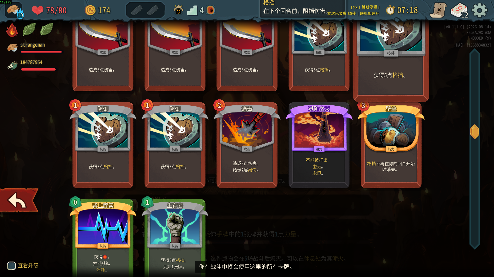

# IntermissionTrade

《杀戮尖塔 2》联机 Mod：在幕间和队友交换卡牌，让暂时派不上用场的牌成为队友的助力。



**当前版本：** `v0.1.0`（开发预览）

**作者：** hw

**依赖：** BaseLib 3.4.7 或更高版本

## 功能

- 第一幕、第二幕的卡牌奖励全部选完后，进入幕间交换阶段；第三幕结束后不触发交换。
- 点击队友昵称发送请求。对方可以同意或拒绝；拒绝不会消耗发起机会，可以再次请求。
- 双方各自从整副牌组中选择一张非诅咒牌。两人都确认后才完成互换，卡牌原有状态随卡牌保留。
- 每位玩家每幕最多成功主动发起一次交换。接收请求不会消耗自己的发起机会。
- 玩家可以跳过；成功完成主动交换的玩家会自动计入本幕已完成操作的人数。

## 安装

游戏需要通过 Steam 启动，并启用游戏内的 Mod 支持。将发布包中的文件放进游戏目录下的 `mods/IntermissionTrade/` 文件夹：

```text
IntermissionTrade/
├── IntermissionTrade.dll
├── IntermissionTrade.json
└── IntermissionTrade.pck
```

还需要安装 **BaseLib 3.4.7 或更高版本**。这是影响游戏玩法的联机 Mod，建议所有联机玩家安装相同版本的 IntermissionTrade 和 BaseLib。

目前项目处于开发预览阶段，尚未发布经过完整多人联机验证的安装包。

## 从源码构建

### 环境要求

- Windows 版《杀戮尖塔 2》及 Steam 客户端
- Visual Studio 2022，安装 .NET 桌面开发工作负载
- 能够构建 `net9.0` 项目的 .NET SDK
- MegaDot / Godot 4.5.1 Mono，用于导出 Mod 资源包 `.pck`

### 构建步骤

1. 克隆仓库，并用 Visual Studio 打开 `IntermissionTrade.sln`。
2. 在项目根目录创建本机专用的 `Directory.Build.props`，填写 MegaDot/Godot 4.5.1 Mono 可执行文件路径。此文件已加入 `.gitignore`，不要提交个人电脑的绝对路径。

   ```xml
   <Project>
     <PropertyGroup>
       <GodotPath>C:\path\to\MegaDot_v4.5.1-stable_mono_win64.exe</GodotPath>
     </PropertyGroup>
   </Project>
   ```

3. 在 Visual Studio 中恢复 NuGet 包，然后选择 **生成 → 发布 IntermissionTrade**。发布流程会生成 DLL，并导出包含封面等 Godot 资源的 PCK 到游戏的 `mods/IntermissionTrade/` 目录。
4. 从 Steam 启动游戏，在 Mod 设置中启用 IntermissionTrade 和 BaseLib。

`Sts2PathDiscovery.props` 会尝试自动查找 Steam 中的游戏目录。如果自动查找失败，需要在本机 MSBuild 配置中指定游戏路径。

## 开发状态

Mod 的幕间交换界面、请求流程和卡牌交换逻辑正在迭代。多人同步、断线恢复及完整游戏流程仍需继续验证；构建成功不代表多人功能已经通过实测。

新增或修改的 C# 代码请使用详细中文注释，说明用途、关键逻辑和联机同步相关处理。
